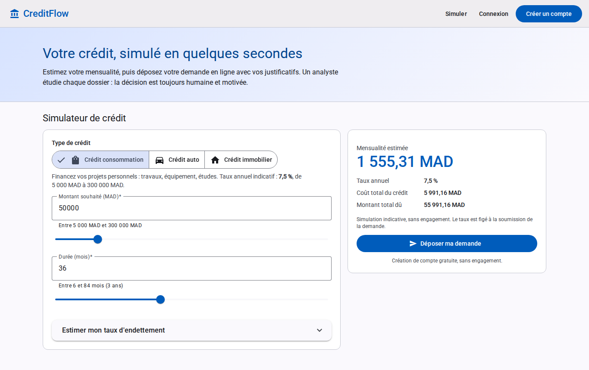
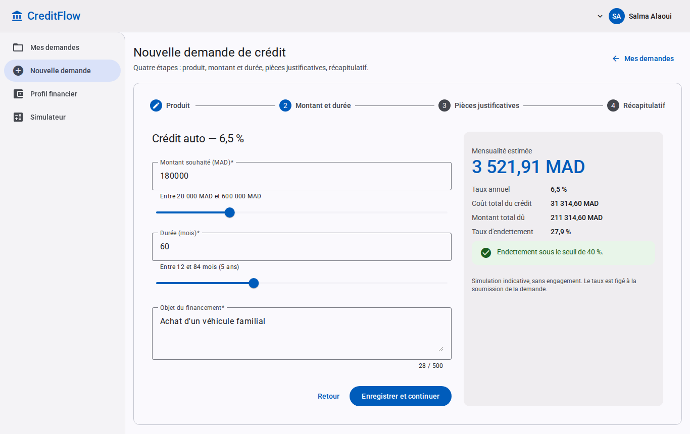
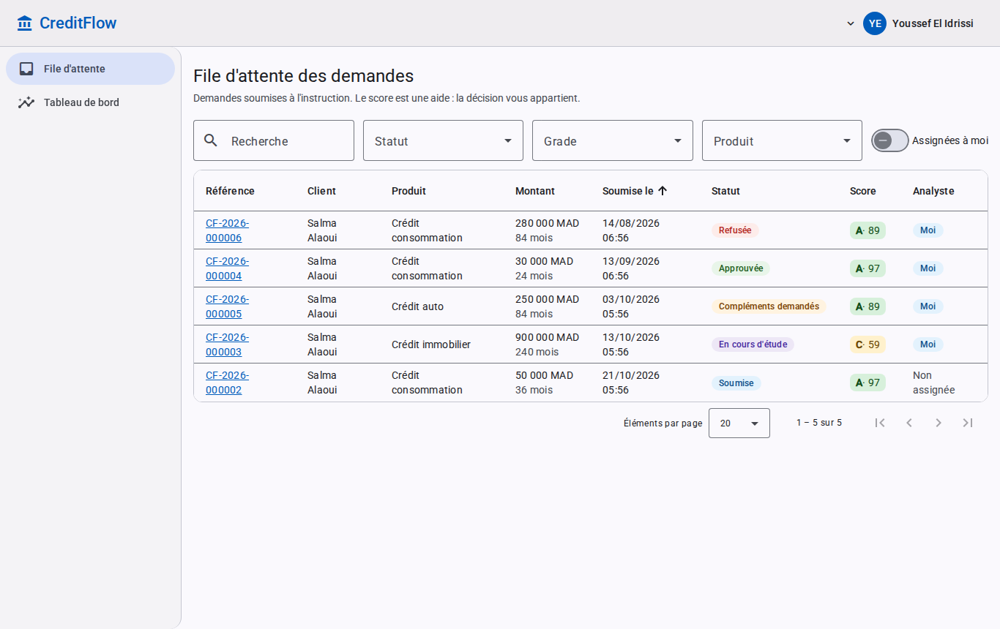
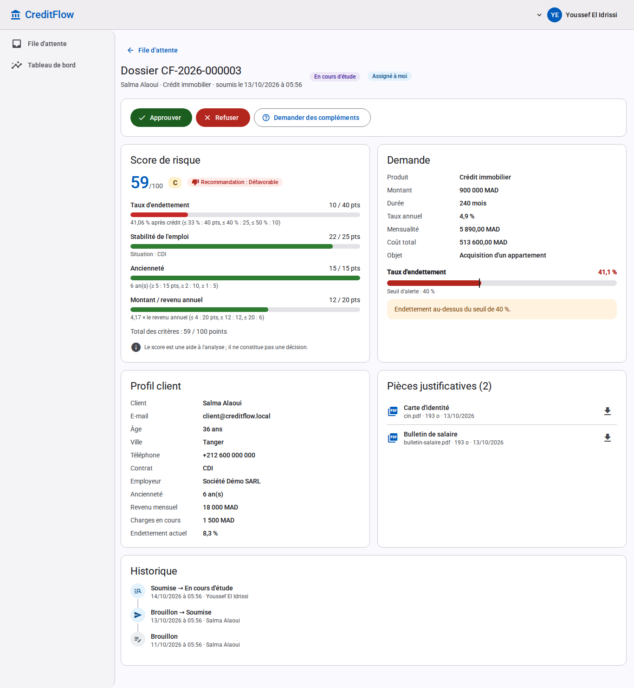
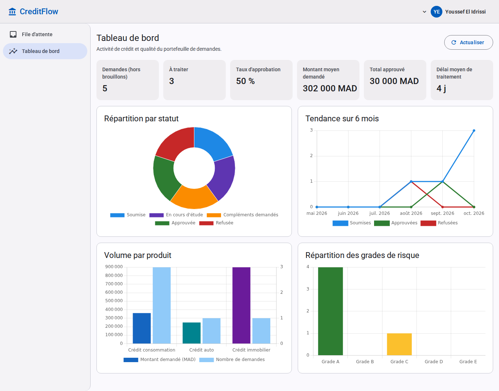
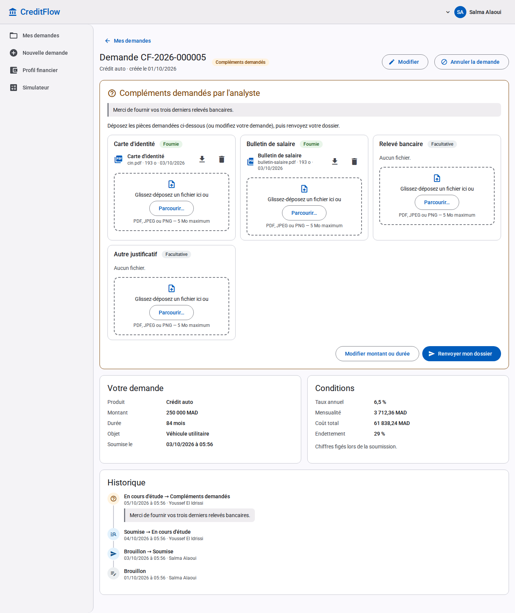

# CreditFlow

Plateforme de gestion des **demandes de crédit** d'une banque : le client simule puis dépose une demande avec ses pièces justificatives ; un analyste instruit le dossier, aidé d'un **score de risque** calculé automatiquement, puis approuve, refuse ou demande des compléments ; un administrateur gère les utilisateurs et les produits de crédit.

> **La décision est toujours humaine.** Le score et la recommandation aident l'analyste ; ils ne déclenchent jamais d'approbation ni de refus automatique.

Backend **ASP.NET Core (.NET 10)** en Clean Architecture, base **SQL Server** (PostgreSQL également pris en charge, utilisé notamment pour les tests), frontend **Angular 22** (Angular Material), conteneurisation **Docker Compose**, **CI GitHub Actions**. La spécification fonctionnelle, source commune du backend et du frontend, est dans [`docs/SPEC.md`](docs/SPEC.md).

## Sommaire

- [Captures d'écran](#captures-décran)
- [Fonctionnalités par rôle](#fonctionnalités-par-rôle)
- [Architecture](#architecture)
- [Scoring de risque](#scoring-de-risque)
- [Stack technique](#stack-technique)
- [Démarrage avec Docker Compose](#démarrage-avec-docker-compose)
- [Démarrage sans Docker (développement)](#démarrage-sans-docker-développement)
- [Configuration](#configuration)
- [Comptes de démonstration](#comptes-de-démonstration)
- [Tests](#tests)
- [Intégration continue](#intégration-continue)
- [Sécurité](#sécurité)
- [Limites connues](#limites-connues)
- [État d'avancement](#état-davancement)
- [Licence](#licence)

## Captures d'écran

Captures de l'application réelle avec les données de démonstration (environnement Development).

| Simulateur public | Nouvelle demande (simulation en direct) |
|---|---|
|  |  |
| **File d'instruction (analyste)** | **Dossier : décomposition du score** |
|  |  |
| **Tableau de bord** | **Suivi d'une demande (client)** |
|  |  |

## Fonctionnalités par rôle

| Rôle | Écrans (UI en français) | Ce que le rôle peut faire |
|---|---|---|
| Public | `/` simulateur, `/connexion`, `/inscription` | Simuler un crédit en direct (mensualité, coût total, taux d'endettement), créer un compte client |
| **Client** | `/client/profil`, `/client/demandes`, `/client/demandes/nouvelle`, `/client/demandes/:id` | Renseigner son profil financier ; créer une demande (assistant pas à pas : produit, montant et durée avec simulation et alerte d'endettement, pièces justificatives, récapitulatif, soumission) ; modifier un brouillon ou répondre à une demande de compléments ; annuler ; suivre la chronologie de sa demande. Un client ne voit que ses propres demandes et pièces (sinon 404). |
| **Analyste** | `/analyste/file`, `/analyste/dossiers/:id`, `/analyste/tableau-de-bord` | File des demandes paginée, filtrée et triée ; s'assigner un dossier ; consulter le profil du client, la **décomposition du score**, les pièces et l'historique ; approuver, refuser ou demander des compléments (commentaire obligatoire) ; tableau de bord (indicateurs et graphiques). Seul l'analyste assigné (ou un admin) décide. |
| **Admin** | écrans analyste + `/admin/utilisateurs`, `/admin/produits` | Créer des comptes analyste/admin, activer/désactiver un compte, changer un rôle (pas sur son propre compte) ; paramétrer les produits de crédit (taux, bornes de montant et de durée, activation). |

Cycle de vie d'une demande (machine à états du domaine, chaque transition est historisée) :

```
DRAFT --submit--> SUBMITTED --assign--> UNDER_REVIEW --approve-----> APPROVED
  |                   |                      |-------reject------> REJECTED
  |                   |                      '--request-info--> INFO_REQUESTED --submit--> SUBMITTED
  '--cancel--> CANCELLED <--cancel-- (SUBMITTED, INFO_REQUESTED : par le client)
```

Toute autre transition est refusée (HTTP 409).

## Architecture

### Clean Architecture (backend, `backend/src`)

```
             ┌──────────────────────────────────────────────┐
             │ CreditFlow.Api                               │  contrôleurs fins, auth JWT, ProblemDetails,
             │ (ASP.NET Core)                               │  CORS, limitation de débit, OpenAPI (dev)
             └───────────────┬──────────────────────────────┘
                             │ référence
             ┌───────────────▼──────────────────────────────┐
             │ CreditFlow.Infrastructure                    │  EF Core (SQL Server / PostgreSQL), Identity,
             │                                              │  jetons, stockage des pièces, seed
             └───────────────┬──────────────────────────────┘
                             │ implémente les interfaces de
             ┌───────────────▼──────────────────────────────┐
             │ CreditFlow.Application                       │  cas d'usage, validation (FluentValidation),
             │                                              │  interfaces (persistance, IFileStorage...)
             └───────────────┬──────────────────────────────┘
                             │
             ┌───────────────▼──────────────────────────────┐
             │ CreditFlow.Domain                            │  entités, machine à états, scoring :
             │ (aucune dépendance)                          │  code pur, sans base ni framework
             └──────────────────────────────────────────────┘
```

Tests : `tests/CreditFlow.Domain.Tests`, `tests/CreditFlow.Application.Tests` (unitaires) et `tests/CreditFlow.Api.IntegrationTests` (API réelle via `WebApplicationFactory` sur une vraie base). Chaque fournisseur de base a son propre jeu de migrations EF Core (`Infrastructure/Persistence/Migrations/SqlServer` et `.../PostgreSQL`).

### Exécution (Docker Compose)

```
 Navigateur ──HTTP──► frontend : nginx non root (127.0.0.1:8080 → 8080)
                       ├─ /            SPA Angular (repli sur index.html)
                       └─ /api/...  ──► api : ASP.NET Core, UID 1654 (api:8080, non publié)
                                         ├─ SQL Server 2022 (sqlserver:1433, volume sqlserver-data)
                                         └─ pièces justificatives (volume documents)
```

La SPA appelle l'API en relatif (`/api/v1`) : en production, nginx relaie sur la même origine (pas de CORS côté navigateur) ; en développement, `ng serve` relaie via `frontend/proxy.conf.json`.

## Scoring de risque

Service de domaine pur, entièrement couvert par des tests unitaires. Résumé (règles complètes et exactes : [`docs/SPEC.md`](docs/SPEC.md#scoring-service-de-domaine-pur-sans-base-entièrement-testé)) :

- **Mensualité** (annuité) : `M = P·r / (1 − (1 + r)^−n)` avec `r = taux annuel / 12 / 100` ; coût total `M·n − P`.
- **Taux d'endettement** : `(charges mensuelles + M) / revenu mensuel`.
- **Score sur 100** = endettement (40 max) + stabilité de l'emploi (25 max) + ancienneté (15 max) + rapport montant / revenu annuel (20 max, seuils ×4 pour l'immobilier).
- **Grade** : A ≥ 80, B ≥ 65, C ≥ 50, D ≥ 35, E < 35.
- **Recommandation** : `DEFAVORABLE` si endettement > seuil (40 % par défaut, `Scoring:MaxDebtRatio`) ou grade D/E ; `FAVORABLE` si grade A/B et seuil respecté ; sinon `A_ETUDIER`.
- Le score, le taux et la mensualité sont **figés à la soumission** ; l'analyste voit le détail des points par critère.

## Stack technique

| Couche | Technologies |
|---|---|
| Backend | .NET 10 (SDK ≥ 10.0.100, cf. `backend/global.json`), ASP.NET Core, EF Core 10 (SQL Server, Npgsql), ASP.NET Core Identity, JWT Bearer, FluentValidation, Serilog, OpenAPI + Scalar (développement), Central Package Management |
| Frontend | Angular 22 (composants autonomes, formulaires réactifs typés), Angular Material / CDK, Chart.js (ng2-charts), polices auto-hébergées, Vitest + jsdom, ESLint (angular-eslint), Prettier |
| Données | SQL Server 2022 (production / Compose), PostgreSQL (tests et développement) |
| Conteneurs | Images multi-étapes : `dotnet/sdk:10.0` → `dotnet/aspnet:10.0` (non root) ; `node:24-slim` → `nginxinc/nginx-unprivileged:1.30-alpine` |
| CI | GitHub Actions : build, format, tests (SQL Server et PostgreSQL), lint, build Docker, test de fumée Compose, gitleaks, audit des dépendances |

## Démarrage avec Docker Compose

Prérequis : Docker avec Compose v2, environ 2 Go de RAM libres pour SQL Server. L'image SQL Server est publiée pour **x86-64 uniquement** (sur Apple Silicon, passer par l'émulation de Docker Desktop, ou utiliser PostgreSQL hors Docker).

```bash
cp .env.example .env
# Renseigner au minimum MSSQL_SA_PASSWORD et JWT_SIGNING_KEY, par exemple :
#   MSSQL_SA_PASSWORD -> echo "Cf1-$(openssl rand -hex 16)"
#   JWT_SIGNING_KEY   -> openssl rand -base64 48
docker compose up -d --build --wait
```

Puis ouvrir <http://localhost:8080>. Au premier démarrage, l'API applique les migrations (`Database__MigrateOnStartup=true` dans `docker-compose.yml`) puis crée les rôles et les produits de crédit initiaux.

- État : `docker compose ps` (les trois services exposent un healthcheck) ; santé de l'API : <http://localhost:8080/api/v1/health>.
- Journaux : `docker compose logs -f api`.
- Arrêt : `docker compose down` (ajouter `-v` pour supprimer aussi la base et les pièces).
- Seul le frontend est publié (sur `127.0.0.1` par défaut) ; SQL Server est publié sur `127.0.0.1:1433` pour les outils locaux ; l'API n'est joignable qu'à travers nginx.
- Pour avoir les **comptes de démonstration** et l'interface OpenAPI/Scalar, passer `ASPNETCORE_ENVIRONMENT=Development` et renseigner les mots de passe `SEED_*` dans `.env` (voir [Comptes de démonstration](#comptes-de-démonstration)). Scalar (`/scalar`) n'est alors pas relayé par nginx : il n'est accessible qu'en lançant l'API hors conteneur.

## Démarrage sans Docker (développement)

Prérequis : .NET SDK 10.0.100 ou plus récent, Node.js 24 et npm, et une base **PostgreSQL** ou **SQL Server** locale. Pour SQL Server, `docker compose up -d sqlserver` suffit (seul `MSSQL_SA_PASSWORD` est requis dans `.env`).

**1. API** (écoute sur <http://localhost:5080>, profil `http` de `launchSettings.json`) :

```bash
cd backend
# Secrets de développement, hors dépôt (user-secrets) :
dotnet user-secrets set "Jwt:SigningKey" "$(openssl rand -base64 48)" --project src/CreditFlow.Api
# Base : en Development, PostgreSQL local (localhost:5432, utilisateur et mot de passe postgres, base creditflow_dev :
# voir appsettings.Development.json).
# Pour une autre base PostgreSQL, surcharger ConnectionStrings:Default ; pour SQL Server :
dotnet user-secrets set "Database:Provider" "SqlServer" --project src/CreditFlow.Api
dotnet user-secrets set "ConnectionStrings:Default" "Server=localhost,1433;Database=CreditFlow_dev;User Id=sa;Password=<mot de passe>;TrustServerCertificate=True" --project src/CreditFlow.Api
# Comptes de démonstration (facultatif) :
dotnet user-secrets set "Seed:AdminPassword" "<mot de passe>" --project src/CreditFlow.Api

Database__MigrateOnStartup=true dotnet run --project src/CreditFlow.Api
```

En Development : OpenAPI sur <http://localhost:5080/openapi/v1.json> et interface Scalar sur <http://localhost:5080/scalar>. Sans `Database:MigrateOnStartup`, l'API signale les migrations en attente ; elles peuvent aussi être appliquées avec l'outil local `dotnet ef` (`dotnet tool restore`).

**2. Frontend** (<http://localhost:4200>, `/api` relayé vers `localhost:5080`) :

```bash
cd frontend
npm ci
npm start
```

## Configuration

Toutes les valeurs se fournissent par variables d'environnement (`Section__Cle`), `appsettings.*.json` ou user-secrets. Aucun secret n'est versionné.

| Clé | Rôle | Valeur par défaut |
|---|---|---|
| `Database:Provider` | `SqlServer` ou `PostgreSQL` | `SqlServer` (`PostgreSQL` en Development) |
| `ConnectionStrings:Default` | Chaîne de connexion | vide (obligatoire) |
| `Database:MigrateOnStartup` | Appliquer les migrations EF Core au démarrage | `false` (`true` dans Compose) |
| `Database:StartupConnectRetries` | Tentatives de connexion à la base au démarrage | `10` |
| `Jwt:SigningKey` | Clé HMAC des jetons d'accès, **≥ 32 octets** : démarrage refusé sinon | aucune |
| `Jwt:AccessTokenMinutes` / `Jwt:RefreshTokenDays` | Durées de vie des jetons | `15` / `7` |
| `Cors:AllowedOrigins` | Origines autorisées (tableau ; `Cors__AllowedOrigins__0=...`) | aucune (`http://localhost:4200` en Development) |
| `Storage:RootPath` | Dossier des pièces justificatives | `App_Data/uploads` (`/var/lib/creditflow/documents` dans l'image) |
| `DataProtection:KeysPath` | Dossier des clés Data Protection d'ASP.NET Core | aucun : emplacement par défaut d'ASP.NET Core (`/var/lib/creditflow/keys` dans l'image) |
| `Scoring:MaxDebtRatio` | Seuil d'endettement de la recommandation | `0.40` |
| `RateLimiting:*` | Limites `/auth/*` et globale (fenêtres fixes) | 10 req/60 s sur `/auth`, 300 req/60 s global |
| `ForwardedHeaders:Enabled` | Faire confiance à `X-Forwarded-For/Proto` (derrière nginx) | `false` (`true` dans Compose) |
| `Auth:RefreshCookieSecure` | Forcer l'attribut `Secure` du cookie de refresh | `Secure` hors Development |
| `Seed:DemoData`, `Seed:*Email`, `Seed:*Password` | Données de démonstration (Development uniquement) | voir ci-dessous |

Variables propres à Docker Compose (fichier `.env`, modèle commenté dans [`.env.example`](.env.example)) : `MSSQL_SA_PASSWORD` (obligatoire), `JWT_SIGNING_KEY`, `ASPNETCORE_ENVIRONMENT`, `MSSQL_DATABASE`, `MSSQL_PID`, `MSSQL_HOST_PORT`, `CORS_ALLOWED_ORIGIN`, `FRONTEND_BIND_ADDRESS`, `FRONTEND_PORT`, `SEED_ADMIN_PASSWORD`, `SEED_ANALYST_PASSWORD`, `SEED_CLIENT_PASSWORD`, `IMAGE_TAG`.

## Comptes de démonstration

Créés **uniquement en environnement Development** (`Seed:DemoData=true`), avec quelques demandes à différents statuts :

| Rôle | E-mail | Mot de passe |
|---|---|---|
| Admin | `admin@creditflow.local` | `Seed:AdminPassword` |
| Analyste | `analyste@creditflow.local` | `Seed:AnalystPassword` |
| Client | `client@creditflow.local` | `Seed:ClientPassword` |

Les mots de passe ne sont **jamais** dans le dépôt : un compte dont le mot de passe n'est pas configuré n'est pas créé (avertissement dans les journaux). Politique des mots de passe : 8 caractères minimum, dont une majuscule, une minuscule, un chiffre et un caractère spécial.

## Tests

```bash
# Backend : tests unitaires (domaine, cas d'usage)
cd backend
dotnet test tests/CreditFlow.Domain.Tests
dotnet test tests/CreditFlow.Application.Tests

# Backend : tests d'intégration (API réelle + vraie base, recréée à chaque exécution)
# Le nom de la base doit contenir « test » (garde-fou contre une base réelle).
export CREDITFLOW_TEST_DB_PROVIDER=SqlServer   # ou PostgreSQL
export CREDITFLOW_TEST_DB="Server=localhost,1433;Database=creditflow_test;User Id=sa;Password=<mot de passe>;TrustServerCertificate=True"
dotnet test tests/CreditFlow.Api.IntegrationTests

# Avec couverture (rapport Cobertura dans TestResults/)
dotnet test --collect "XPlat Code Coverage" --results-directory TestResults

# Format / analyseurs (les avertissements sont des erreurs dans src/)
dotnet format CreditFlow.slnx --verify-no-changes

# Frontend
cd ../frontend
npm run lint
npm test          # Vitest, non interactif
npm run build     # sortie : dist/creditflow/browser

# Bout en bout (Playwright, Chromium) : API + build de production Angular + vraie base
# Base PostgreSQL dédiée (nom contenant « e2e » ou « test »), jamais vidée : chaque test crée ses comptes.
cd ../e2e
npm ci && npm run install-browser
export E2E_DB="Host=localhost;Port=5432;Database=creditflow_e2e;Username=postgres;Password=postgres"
npm run stack     # build et démarre l'API (:5080) et la SPA (:4200, /api relayé)
npm test
npm run stop
```

Les tests de bout en bout couvrent le simulateur public, le parcours complet (inscription, profil, demande en 4 étapes avec pièces, refus d'une fausse pièce PDF, instruction par l'analyste, demande de compléments, renvoi, approbation, téléchargement d'une pièce), la restauration de session par le cookie, les pages interdites par rôle, la déconnexion, et la création puis la désactivation d'un compte analyste par l'admin.

## Intégration continue

Workflow [`.github/workflows/ci.yml`](.github/workflows/ci.yml), déclenché sur `push` vers `main`, sur chaque pull request et manuellement. Permissions minimales (`contents: read`), exécutions concurrentes annulées, actions épinglées sur des versions majeures. **Aucun déploiement** et aucun secret requis.

| Job | Contenu |
|---|---|
| `backend` | `dotnet restore` → `build -c Release` → `dotnet format --verify-no-changes` → tests unitaires → tests d'intégration contre un conteneur **SQL Server 2022** ; résultats TRX et couverture Cobertura publiés en artefact, résumé de couverture dans la page du run |
| `backend-postgres` | Mêmes tests d'intégration contre **PostgreSQL 17 et 18** (matrice) |
| `frontend` | Node 24, `npm ci`, lint, tests Vitest, build de production |
| `e2e` | Pile complète sur un conteneur **PostgreSQL 17** : API, build de production Angular, tests **Playwright** (Chromium) ; journaux et traces publiés en cas d'échec |
| `docker` | Build des deux images (Buildx, cache GitHub Actions, sans push), puis `docker compose up --wait` avec un `.env` aléatoire jetable : santé de l'API, SPA et repli `index.html`, en-têtes de sécurité, `GET /api/v1/products` relayé par nginx jusqu'à SQL Server |
| `security` | gitleaks sur **tout l'historique** git (binaire vérifié par somme SHA-256), paquets NuGet vulnérables (directs et transitifs, échec si au moins un), `npm audit --omit=dev --audit-level=high` |

Les mots de passe des bases de CI sont jetables, propres à chaque exécution et non secrets (conteneurs éphémères du runner).

## Sécurité

- **Authentification** : JWT d'accès de 15 min, gardé **en mémoire** côté SPA (jamais dans `localStorage`/`sessionStorage`) ; refresh token de 7 jours dans un cookie `HttpOnly`, `SameSite=Strict`, `Path=/api/v1/auth`, `Secure` hors Development, stocké **haché (SHA-256)**, avec **rotation** et détection de rejeu (un rejeu révoque toute la famille de jetons) ; un seul refresh partagé côté SPA.
- **Comptes** : verrouillage après 5 échecs (15 min) ; un compte désactivé ou dont le rôle change perd ses sessions, et chaque requête vérifie l'état du compte et son empreinte de sécurité ; limitation de débit sur `/auth/*` (HTTP 429).
- **Autorisation** : politiques par rôle, politique par défaut « authentifié », contrôle par ressource (un client ne voit que ses demandes : 404 sinon) ; gardes de routes par rôle côté SPA.
- **Pièces justificatives** : PDF/JPEG/PNG, 5 Mo maximum, type vérifié par **signature binaire**, nom de stockage aléatoire, dossier hors racine web (volume dédié).
- **Concurrence** : jeton de version sur les demandes (`If-Match` / `ETag`, conflit ⇒ 409).
- **En-têtes HTTP** : l'API pose `nosniff`, `X-Frame-Options: DENY`, `Referrer-Policy`, CSP `default-src 'none'`, `Cache-Control: no-store` ; nginx sert la SPA avec une CSP stricte (`script-src 'self'`, aucune ressource tierce), `X-Frame-Options`, `Permissions-Policy`, `Cross-Origin-Opener-Policy`.
- **Conteneurs** : utilisateurs non root (API UID 1654, nginx UID 101), `cap_drop: ALL`, `no-new-privileges`, système de fichiers en lecture seule pour nginx, binaires de l'API non modifiables par l'utilisateur applicatif, ports liés à `127.0.0.1`.
- **Erreurs** : réponses `ProblemDetails` (RFC 7807) sans détail interne ; journaux structurés sans corps, en-têtes ni jetons.
- **Chaîne d'approvisionnement** : versions NuGet centralisées, audit NuGet à la restauration (`NuGetAuditMode=all`) et en CI, `npm audit`, gitleaks.

## Limites connues

- **TLS** : nginx sert du HTTP sur le port 8080 ; un déploiement réel doit placer un reverse proxy TLS en amont (et y ajouter HSTS). Le cookie de refresh étant `Secure` hors Development, l'application ne fonctionne en HTTP que sur `localhost`, que les navigateurs considèrent comme un contexte sécurisé.
- **Compte `sa`** : la chaîne de connexion de Compose utilise le compte administrateur SQL Server, ce qui est acceptable pour une démonstration locale mais pas en production (login dédié aux droits limités, migrations appliquées par un compte distinct).
- **Migrations au démarrage** (`MigrateOnStartup`) : pratique pour une instance unique ; avec plusieurs instances, appliquer les migrations en amont (`dotnet ef migrations bundle` ou script SQL idempotent).
- **Clés Data Protection** d'ASP.NET Core persistées sur disque (volume `dataprotection-keys` dans Compose, `DataProtection:KeysPath`) mais non chiffrées au repos ; avec plusieurs instances, les partager (stockage commun) et les protéger (certificat ou coffre de clés).
- **Stockage des pièces** sur disque local (volume) : pas d'antivirus, de chiffrement applicatif ni de stockage objet.
- **Interface Scalar** non relayée par nginx (disponible seulement en lançant l'API hors conteneur, en Development).
- **Observabilité** : journaux console uniquement (pas de métriques, de traces ni d'alerting).
- **Pas de déploiement** : aucune image n'est publiée dans un registre et aucun environnement d'hébergement n'est fourni.

## État d'avancement

Vérifications faites en local le 22/10/2026 sur une copie du code de ce jour :

| Élément | État |
|---|---|
| Backend (domaine, cas d'usage, API REST de la spécification) | Implémenté ; build Release sans avertissement, `dotnet format` propre |
| Tests backend | Au vert : 189 tests du domaine, 118 de la couche application, 67 tests d'intégration exécutés contre SQL Server 2022 **et** contre PostgreSQL 17 |
| Frontend (parcours public, client, analyste, admin) | Implémenté ; lint et build de production au vert ; 168 tests Vitest au vert, y compris sous forte charge machine (délais de test relevés à 30 s) |
| Images Docker et `docker compose` | Construites et démarrées localement : santé, SPA, inscription, connexion, dépôt de pièces et soumission vérifiés à travers nginx |
| Workflow GitHub Actions | Validé statiquement (actionlint + shellcheck, hadolint pour les Dockerfiles) ; **à valider au premier run GitHub** (services de CI, cache Buildx, matrice PostgreSQL 18, gitleaks sur l'historique réel) |
| Couverture de code | Rapports Cobertura générés ; **valeurs à constater au premier run GitHub** (non mesurables dans l'environnement de développement utilisé) |
| Tests de bout en bout (Playwright, dossier `e2e/`) | 4 scénarios au vert en local (navigateur réel, API sur PostgreSQL) ; job `e2e` de la CI **à valider au premier run GitHub** |
| Captures d'écran | Faites sur l'application réelle (`docs/screenshots/`) |

## Licence

**À définir.** Aucun fichier `LICENSE` n'est fourni pour l'instant : sans licence explicite, le code n'est pas réutilisable librement.
